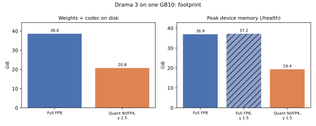
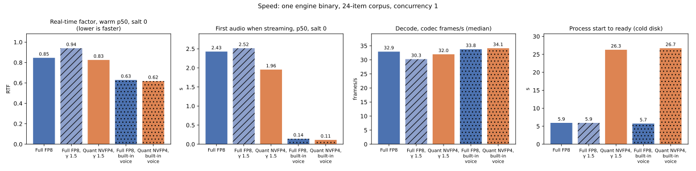
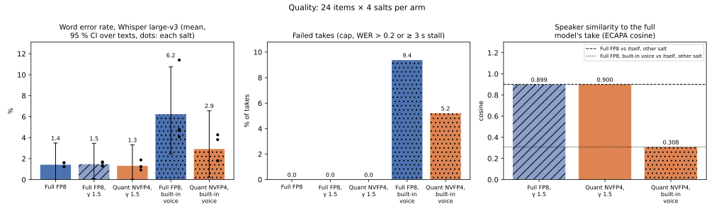

## Full model against this quant

One NVIDIA GB10, one engine binary for every arm, the 24 English texts of the bench corpus (`bench/corpus/drama-bench-en-v1.jsonl`, sha256 `b8995194915f…`) one request at a time, and 4 seed salts (0, 1, 2, 3) per arm. Every number below comes from the files of run `run-01` through `bench/full-vs-quant/report.py`; the per-request records are in `raw/`.

| Arm | Checkpoint | Voice | Engine arguments |
|---|---|---|---|
| Full FP8 | full | reference voice | `serve --context 8192 --parallel 1 --no-drafts --prompt-cache-gib 0 --keep-warm 0 --max-frames 1024` |
| Quant NVFP4, γ 1.5 | quant | reference voice | `serve --context 8192 --parallel 1 --no-drafts --prompt-cache-gib 0 --keep-warm 0 --max-frames 1024 --cfg-gamma 1.5 --cfg-batched` |
| Full FP8, γ 1.5 | full | reference voice | `serve --context 8192 --parallel 1 --no-drafts --prompt-cache-gib 0 --keep-warm 0 --max-frames 1024 --cfg-gamma 1.5 --cfg-batched` |
| Full FP8, built-in voice | full | built-in voice | `serve --context 8192 --parallel 1 --no-drafts --prompt-cache-gib 0 --keep-warm 0 --max-frames 1024` |
| Quant NVFP4, built-in voice | quant | built-in voice | `serve --context 8192 --parallel 1 --no-drafts --prompt-cache-gib 0 --keep-warm 0 --max-frames 1024 --cfg-gamma 1.5 --cfg-batched` |

### The recipe

- **Quant.** NVFP4 routed experts (GPTQ), 7,369 of 10,240 kept. At start-up the engine reports 19.05 GiB of model weights against 36.90 GiB for the full FP8 checkpoint, 7,369 of 10,240 routed experts held and NVFP4 routed experts in 40 of 40 layers. Weights and codec on disk: 20.76 GiB against 38.63 GiB.
- **Engine.** TensorFold native (Zig/CUDA), build `v1.0.11-193-g70dec469` from branch `exp/g6-codec-chunk`, clean tree: yes; binary sha256 `3815f416e351…`. Sampling as the engine reports it: greedy. The quant is served with guidance γ 1.5 (`--cfg-gamma 1.5 --cfg-batched`): a second, unconditioned backbone sequence run in one batch with the first. The full-model arm with the same guidance (FG) separates the effect of guidance from the effect of the quant. With the built-in voice the engine logged γ 1.00 on every reply of QB, so guidance was inactive there. The engine arguments in the table above are complete; none sets a redraw or retry.
- **Codec.** The quant ships Drama 3's codec weights unchanged: `codec.pth` has the same sha256 (`74fc41c5a715…`) in both checkpoints' pins. The engine binary decodes it with codec scratch kept per chunk, a host-side change (the build record is in `tables.json` under `environment.engine_build.change`).

### Results

| Measure | Full FP8 | Quant NVFP4, γ 1.5 | Full FP8, γ 1.5 | Full FP8, built-in voice | Quant NVFP4, built-in voice |
|---|---:|---:|---:|---:|---:|
| Weights + codec on disk (GiB) | 38.63 | 20.76 | 38.63 | 38.63 | 20.76 |
| Peak device memory, /health (GiB) | 36.95 | 19.35 | 37.20 | 36.95 | 19.35 |
| Host MemAvailable drop, max (GiB) | 39.34 | 21.27 | 39.37 | 38.67 | 21.23 |
| Process start to ready, median of 4 cold starts (s) | 5.9 | 26.3 | 5.9 | 5.7 | 26.7 |
| Engine load, median (s) | 5.7 | 26.1 | 5.8 | 5.6 | 26.5 |
| Real-time factor, warm p50, salt 0 (all warm passes) | 0.846 | 0.825 | 0.940 | 0.629 | 0.618 |
| Real-time factor, warm p95, salt 0 (all warm passes) | 1.539 | 1.462 | 1.832 | 0.670 | 0.656 |
| Real-time factor, p50 of each salt's first warm pass, lowest–highest | 0.853–0.866 | 0.824–0.838 | 0.914–0.941 | 0.627–0.640 | 0.611–0.621 |
| Whole reply, warm p50, salt 0 (s) | 9.53 | 8.38 | 9.30 | 5.33 | 5.37 |
| First audio when streaming, p50, salt 0 (s) | 2.428 | 1.955 | 2.515 | 0.141 | 0.113 |
| Decode, codec frames/s, streamed, salt 0 (median) | 32.9 | 32.0 | 30.3 | 33.8 | 34.1 |
| Prompt tokens per second to first audio (median) | 550 | 681 | 530 | 342 | 430 |
| Prompt tokens per request (median) | 1335 | 1335 | 1335 | 48 | 48 |
| Warm requests succeeded | 72/72 + 72/72 streamed | 72/72 + 72/72 streamed | 72/72 + 72/72 streamed | 72/72 + 72/72 streamed | 72/72 + 72/72 streamed |
| Word error rate, mean [95 % CI] | 1.42 % [0.00, 3.48] | 1.31 % [0.04, 3.32] | 1.47 % [0.08, 3.46] | 6.23 % [2.45, 10.74] | 2.92 % [0.24, 6.57] |
| Word error rate, pooled | 0.60 % | 0.56 % | 0.71 % | 7.09 % | 1.01 % |
| Word error rate, mean of each salt, lowest–highest | 1.23–1.61 % | 0.91–1.88 % | 1.29–1.69 % | 4.08–11.39 % | 1.80–4.27 % |
| Failed takes (cap, collapsed) | 0/96 (cap 0, collapsed 0) | 0/96 (cap 0, collapsed 0) | 0/96 (cap 0, collapsed 0) | 9/96 (cap 0, collapsed 9) | 5/96 (cap 0, collapsed 5) |
| Failed takes per salt (0 / 1 / 2 / 3) | 0 / 0 / 0 / 0 | 0 / 0 / 0 / 0 | 0 / 0 / 0 / 0 | 2 / 2 / 1 / 4 | 0 / 2 / 2 / 1 |
| Engine finish reason, scored takes | stop 96 | stop 96 | stop 96 | silence 7, stop 89 | silence 2, stop 94 |
| Speaker cosine to the full model's take | 0.901 (itself, other salt) | 0.900 | 0.899 | 0.309 (itself, other salt) | 0.308 |

| Paired comparison | Pairs | Failed only in first | Failed only in second | Exact McNemar p | WER difference, mean [95 % CI over items] |
|---|---:|---:|---:|---:|---|
| Quant NVFP4, γ 1.5 vs Full FP8 | 96 | 0 | 0 | 1.000 | -0.11 pp [-0.35, +0.08] |
| Full FP8, γ 1.5 vs Full FP8 | 96 | 0 | 0 | 1.000 | +0.05 pp [-0.24, +0.34] |
| Quant NVFP4, γ 1.5 vs Full FP8, γ 1.5 | 96 | 0 | 0 | 1.000 | -0.16 pp [-0.47, +0.00] |
| Quant NVFP4, built-in voice vs Full FP8, built-in voice | 96 | 3 | 7 | 0.344 | -3.31 pp [-7.88, +0.54] |

Real-time factor is client end-to-end time over audio time (lower is faster). Whole warm passes per salt: 3 / 1 / 1 / 1; streamed warm passes ran only in salt(s) 0 (3 per text). Rows marked salt 0 use only that salt. Quality scores only the first warm pass of each salt's whole replies: 24 takes per salt. A take fails if it reaches the 1024-frame cap or collapses (word error rate above 0.2, or a silence of 3 s or more inside the speech). The 95 % intervals resample the 24 texts 10,000 times. Speaker cosine compares ECAPA embeddings with the full model's take of the same text and salt (F for the reference voice, FB for the built-in voice); the cells marked "itself, other salt" are the baseline: the full model's takes of one text at two different salts.

### Charts

### How quality was scored

Whisper large-v3 transcribed each take; reference and transcript went through Whisper's English normalizer before a word-level edit distance. Speaker embeddings are SpeechBrain `spkrec-ecapa-voxceleb` at 16 kHz. Transcription ran on: cpu float32.

### Run history

- The run started at 2026-10-22T16:44:41+0800 with harness commit `4a00789`.
- The first pass stopped at Quant NVFP4, γ 1.5 salt 0: the benchmark client refused to start it, finding 40 pinned files missing and 0 mismatched. Missing: 39 under `.cache/huggingface/` and `.gitattributes`; all are hidden paths, which the client does not list. No request was sent.
- Pin change (harness commit `7f14908`): the quant checkpoint's sha256sum list went from 59 to 20 entries. Dropped: 39 under `.cache/huggingface/`; added: 0; every kept entry has the same sha256 as before. The resumed preflight verified the quant checkpoint's 20 files (exit 0). The benchmark client got the same list less hidden paths: 19 entries (`.gitattributes` left out), all with the same sha256.
- The run resumed at 2026-10-22T17:37:25+0800. Against the first preflight: binary same, voice same, corpus same, arms same, salts same. Arms measured entirely before the resume, and kept: Full FP8. The set-aside directory (`Q/resume-1-aside-s0`) is in no number here.
